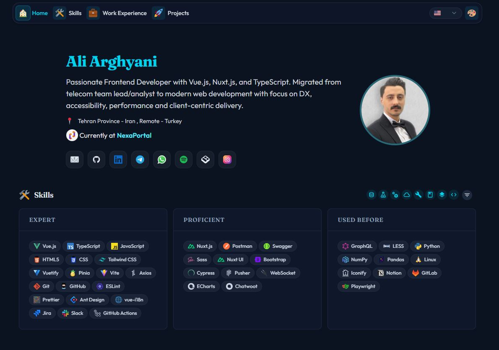

[](https://aliarghyani.ir)

# Nuxt UI Portfolio · Ali Arghyani

A modern, bilingual portfolio built with Nuxt 4, Nuxt UI, Tailwind CSS 4, and TypeScript. Features English and Persian (RTL) support with dark mode as default.

🔗 **Live Demo**: [aliarghyani.ir](https://aliarghyani.ir)

## ✨ Features

- **Nuxt 4** - Latest framework with `app/` directory structure
- **Nuxt UI 4** - Modern component library with custom theming
- **Tailwind CSS 4** - Utility-first styling with custom variants
- **TypeScript** - Full type safety
- **i18n** - English & Persian with automatic RTL switching
- **Dark Mode** - Default theme with light mode option
- **Responsive Images** - Optimized with `@nuxt/image`
- **Performance** - Lazy loading, font preloading, reduced motion support

## � Quick Start

```bash
# Install dependencies
pnpm install

# Start development server
pnpm dev
```

Visit: http://localhost:3000

### Requirements

- Node.js `^20.19.0 || >=22.12.0 <23` (Volta pins `22.14.0`)
- pnpm `9.12.1` (see `packageManager` in `package.json`)

### Available Scripts

```bash
pnpm dev              # Start dev server
pnpm build            # Build for production
pnpm preview          # Preview production build
pnpm generate         # Generate static site
pnpm typecheck        # Run TypeScript checks
pnpm format           # Check code formatting
pnpm format:write     # Fix code formatting
```

## 📁 Project Structure

```
app/                    # Source directory (srcDir)
  ├── app.vue           # Root component
  ├── app.config.ts     # Nuxt UI theme tokens
  ├── error.vue         # Error page (404, 500)
  ├── assets/css/       # Tailwind & global styles
  ├── components/       # Auto-imported components
  │   ├── common/       # Shared UI (TopNav, Footer)
  │   └── portfolio/    # Portfolio components
  ├── composables/      # Auto-imported composables
  ├── data/             # Static content (EN/FA)
  ├── layouts/          # Layout components
  ├── middleware/       # Route middleware
  ├── pages/            # File-based routing
  ├── plugins/          # Nuxt plugins
  ├── types/            # TypeScript definitions
  └── utils/            # Helper functions

server/                 # Server-side code
  └── api/              # API endpoints
      ├── resume/       # On-demand résumé PDF
      └── github/       # Contribution calendar

public/                 # Static assets
  ├── favicon/          # Favicon files
  ├── fonts/            # Local fonts (Roobert, Vazirmatn)
  └── img/              # Images

i18n/                   # Internationalization
  └── locales/          # Translation files (en.json, fa.json)
```

## 🌐 Internationalization

- **Strategy**: `prefix_except_default` (English is default, Persian uses `/fa` prefix)
- **Locales**: English (`en`) and Persian (`fa`) with RTL support
- **Content**: Separate data files for each language in `app/data/`
- **Switching**: Automatic `lang` and `dir` attributes update on locale change

### Content sources

- `app/data/portfolio.ts` owns English profile, capabilities, projects, and work history; `portfolio.en.ts` re-exports it. `portfolio.fa.ts` owns their Persian copy and reuses technology data.
- `app/data/resume.en.ts` owns the concise résumé; `resume.fa.ts` translates it while sharing dates, contact facts, and technology keywords. Both preview and PDF render through `useResumeData` and `ResumePreview`.
- `app/data/aiStack.ts` distinguishes used practices from topics being explored; `mentorship.ts` owns the bilingual mentoring content.
- `content/en/blog` and `content/fa/blog` own writing. Homepage engineering notes select existing articles and read their titles/descriptions through Nuxt Content.
- `i18n/locales` owns interface labels. Homepage descriptions and Person structured data derive from the localized portfolio profile.
- Keep factual changes consistent between portfolio and résumé; their summaries intentionally differ in length. The sync script is an advisory legacy utility, not the PDF data pipeline.

## 🎨 Styling & Theming

- **Tailwind CSS 4** with custom utilities and variants
- **Nuxt UI tokens** in `app.config.ts` for consistent theming
- **Dark mode** as default with `@nuxtjs/color-mode`
- **Local fonts**: Roobert (EN) and Vazirmatn (FA) preloaded for performance
- **Custom chip utility** for tags and badges

## 🚀 Deployment

### Static Site Generation (SSG)

Static generation is available for content pages and blog pre-rendering:

```bash
# Generate static files with pre-rendered blog posts
pnpm generate
```

The build process will:

- Pre-render all blog posts (English & Persian)
- Generate sitemap.xml automatically
- Create RSS feeds for both languages
- Output static files to `.output/public`

### Vercel (Recommended)

The complete site requires the Nuxt server runtime for `/api/resume/pdf` and GitHub activity. Use `pnpm build` with Vercel's Nuxt integration to retain those endpoints. A static-only deployment of `.output/public` cannot generate résumé PDFs on demand. The local production equivalent is `pnpm build` followed by `pnpm preview`.

```bash
# Install Vercel CLI
npm i -g vercel

# Deploy
vercel
```

Or connect your GitHub repository to Vercel for automatic deployments.

### Other Static Hosting Platforms

Content-only static output can be hosted on:

- **Netlify**: Deploy `.output/public` directory
- **Cloudflare Pages**: Connect GitHub repo or upload `.output/public`
- **GitHub Pages**: Deploy `.output/public` contents
- **AWS S3 + CloudFront**: Upload `.output/public` to S3 bucket

**Build Command**: `pnpm generate`  
**Output Directory**: `.output/public`

### Environment Variables

- `NUXT_PUBLIC_LOAD_PLAUSIBLE` - Enable/disable Plausible analytics (optional)
- The production URL is defined in [the shared site configuration](shared/utils/site.ts). See the [deployment guide](docs/deployment-guide.md#production-domain-cutover) for Vercel domain settings.

## 🧪 Testing the Structure

```bash
# Homepage
http://localhost:3000

# Persian version
http://localhost:3000/fa

# 404 error page
http://localhost:3000/non-existent-page
```

Existing browser checks run against a local production preview:

```bash
node scripts/check-portfolio.mjs http://127.0.0.1:3100
node scripts/check-locale-ux.mjs http://127.0.0.1:3100
```

They cover English/Persian, light/dark themes, responsive layouts, contact and navigation, metadata, and résumé/PDF behavior. Set `CHROME_PATH` for the checks and `PUPPETEER_EXECUTABLE_PATH` for the PDF server if using an existing local Chrome installation. There is no dedicated lint or unit-test script; `format` checks Prettier formatting.

## 🛠️ Tech Stack

- **Framework**: Nuxt 4 (Vue 3 + Vite)
- **UI Library**: Nuxt UI 4
- **Styling**: Tailwind CSS 4
- **Language**: TypeScript
- **i18n**: @nuxtjs/i18n
- **Theme**: @nuxtjs/color-mode
- **Images**: @nuxt/image
- **Utilities**: VueUse

## 📝 Auto-imports

Nuxt automatically imports:

- Components from `app/components/`
- Composables from `app/composables/`
- Utils from `app/utils/`

No explicit imports needed!

## 🤝 Contributing

Issues and pull requests are welcome. Please run `pnpm typecheck` and `pnpm format` before submitting changes.

## 📄 License

MIT License - See [LICENSE](./LICENSE) for details.

---

**Made with ❤️ by Ali Arghyani**
